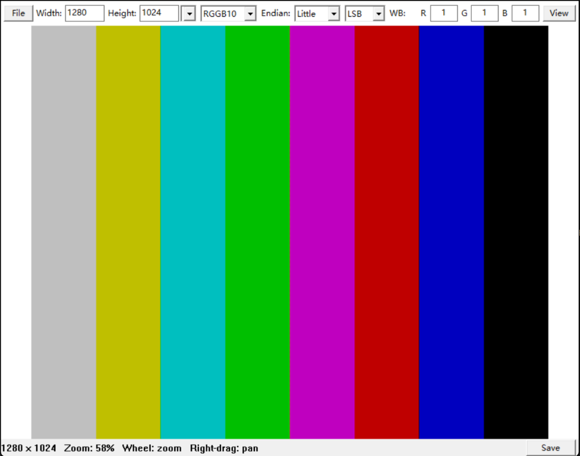

# cc_viewer

**English** | [简体中文](docs/README.zh-CN.md)

A lightweight **RAW image viewer** for Windows, written in C on top of the Win32
API. It is built for inspecting unpacked sensor data — grayscale, packed RGB,
Bayer and YUV — with white balance, a color correction matrix and resolution
presets adjustable on the fly, at the full bit depth of the source data.
Ordinary image files are supported too, as a convenience.



## Features

**RAW viewing**

- Decodes raw sensor dumps from a toolbar or the command line: grayscale,
  packed RGB, Bayer and YUV.
- Selectable resolution, format, byte order and 10/12-bit alignment, so a single
  dump can be re-interpreted without conversion tools.
- Bayer white balance gains and a 3x3 color correction matrix applied at full
  precision before conversion to 8-bit RGB.
- YUV force Y/U/V gains for quick previews.
- Live readout of image size, zoom, cursor position, RGBA value and, for
  grayscale RAW, the raw sample value in hex.

**General viewing**

- Opens BMP, GIF (first frame), JPEG, PNG, TGA, PSD, PIC and PNM images.
- Fit to window, zoom at the mouse cursor, region zoom and right-drag panning.
- Reload, save as BMP with a suggested file name, and persisted settings.
- Unicode file paths.

## Requirements

- Windows
- CMake 3.20 or newer
- A C11 compiler: MinGW-w64 GCC or MSVC

## Build

```powershell
cmake -S . -B build -G Ninja `
  -DCMAKE_MAKE_PROGRAM=ninja.exe `
  -DCMAKE_C_COMPILER=gcc.exe
cmake --build build
```

The executable is written to `build\cc_viewer.exe`. MinGW builds link the
runtime statically, so no compiler DLLs are needed at run time.

## Usage

```powershell
.\build\cc_viewer.exe -f "D:\images\frame.raw" -w 640 -h 480 -m rgb565
.\build\cc_viewer.exe -f "D:\images\frame.raw" -w 1280 -h 1024 -m rggb10 -b --align msb
.\build\cc_viewer.exe "D:\images\photo.png"
```

Without a path, use **File > Open**. Files can also be dropped onto the
executable or onto an open window. `-H` or `--help` prints the command line
reference. For RAW input, `-w`, `-h` and `-m` must be given together; `-b`
selects big-endian 16-bit samples (default little-endian) and `--align lsb|msb`
selects the alignment of 10/12-bit samples (default `lsb`).

### Keyboard and mouse

| Input | Action |
| --- | --- |
| Ctrl+O | Open a file |
| S | Save the displayed image as BMP |
| R | Reload the current file |
| F, Z | Fit to window |
| F1 | Help |
| Mouse wheel | Zoom at the cursor |
| Left drag | Zoom to the selected region |
| Right drag | Pan |

The image cannot be zoomed out below the fit-to-window scale. Pixels are drawn
without smoothing at 100% and above, and with smooth scaling below 100%.

### RAW options

- Enter the resolution and format in the top toolbar, then click **View**.
- For Bayer data, adjust the **WB R/G/B** multipliers and **File > CCM** (a
  modeless 3x3 matrix editor in RGB row order; **Identity** resets it).
- For YUV data, use the **Y/U/V** gains. Y is multiplied directly; U and V are
  adjusted around 128. All results are clamped to the valid range.
- **Save** in the status bar stores the current settings and, for custom
  resolution slots, the selected slot.

View reuses the previous result when the path and settings are unchanged.
Changing only the Bayer matrix reuses the cached full-precision demosaiced data;
reload always re-reads the file.

### Supported formats

| Group | Formats |
| --- | --- |
| Bayer RAW | `rggb`, `grbg`, `bggr`, `gbrg` followed by `8`, `10`, `12` or `16` |
| Grayscale RAW | `gray8`, `gray10`, `gray12`, `gray16` |
| Packed RGB RAW | `rgb555`, `rgb565`, `rgb888` |
| YUV 4:2:2 | `uyvy`, `vyuy`, `yvyu`, `yuyv` |
| YUV 4:2:0 | `yv12`, `i420`, `nv12`, `nv21` |
| Encoded images | BMP, GIF (first frame), JPEG, PNG, TGA, PSD, PIC, PNM |

- RAW data is tightly packed with no row padding. Ten-, twelve- and sixteen-bit
  samples occupy 16-bit containers; packed 10-bit Bayer data is not supported.
- `rgb888` stores bytes in R, G, B order.
- YUV samples are 8-bit and use BT.601 full-range conversion. 4:2:2 requires an
  even width; 4:2:0 requires an even width and height. `YUVP` is not supported.
- Files with a `.raw` extension are always treated as RAW. Other files are
  identified by signature or extension, and unknown files are treated as RAW.
  TGA requires the `.tga` extension because it has no reliable signature.
- Bayer images must be at least 2x2 pixels; boundary pixels use the available
  neighbors during bilinear demosaicing.

### Settings

Settings are stored in `eagle_viewer.ini` next to the executable, so that folder
must be writable. The file keeps its original name for compatibility; the
`[default]`, `[presets]` and `[ccm]` sections hold the last applied RAW
parameters, custom resolution slots and the Bayer matrix. The matrix is stored in
row-major order:

```ini
[ccm]
matrix=[1, 0, 0, 0, 1, 0, 0, 0, 1]
```

Older `m00`–`m22` entries are still read and converted on the next save;
`matrix` takes precedence when both exist.

## Project layout

```text
assets/
  icon_source.png      Source artwork for the application icon
  eagle_viewer.ico     Multi-resolution application icon
  eagle_viewer.rc      Windows icon resource
docs/
  screenshot.png       Screenshot used in this README
  README.zh-CN.md      Simplified Chinese documentation
include/
  bayer.h              Bayer demosaicing interface
  image.h              Image buffer and loading interface
  pixel_render.h       Magnified pixel rendering interface
  raw.h                RAW parameters and decoding interface
  raw_toolbar.h        RAW toolbar interface
  resource.h           Resource identifiers
  save_name.h          BMP file-name generation interface
  stb_image.h          Third-party image decoder
  view_math.h          View transform helpers
  viewer.h             Win32 viewer entry point
  yuv.h                YUV conversion interface
src/
  bayer.c              Bayer demosaicing, white balance and CCM
  ccm_window.c         Modeless Bayer CCM editor
  image.c              File reading and image decoding
  main.c               Application entry point and command line
  pixel_render.c       Visible-region pixel sampling
  raw.c                RAW format registry and decoders
  raw_toolbar.c        RAW settings, presets and persistence
  save_name.c          BMP file-name generation
  view_math.c          View transform helpers
  viewer.c             Window, menus, input and GDI rendering
  yuv.c                YUV to RGB conversion
CMakeLists.txt
LICENSE
README.md
```

## License

cc_viewer is distributed under the terms of the
[GNU General Public License v3.0](LICENSE).

`include/stb_image.h` is bundled third-party code; its dual-license terms are at
the top of the file. The application links only against Windows system
libraries: Win32, GDI, Common Dialogs and Shell.
