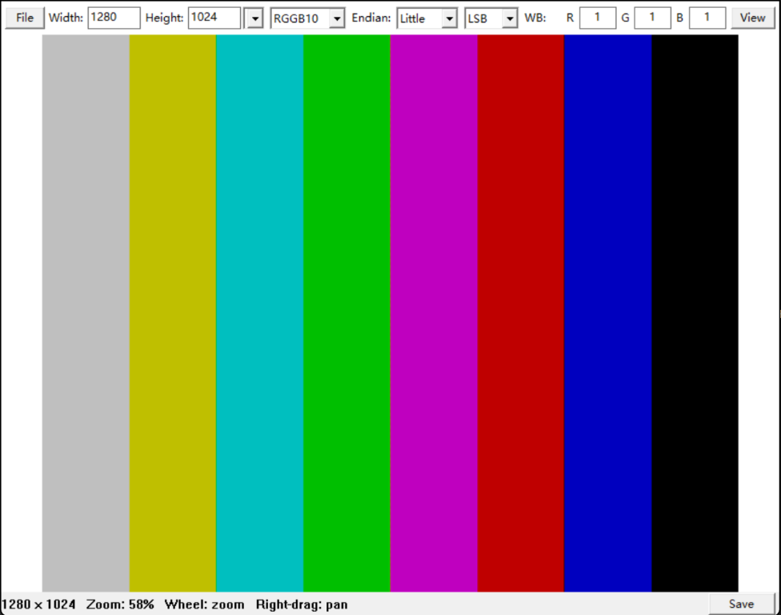

# cc_viewer

[English](../README.md) | **简体中文**

一个轻量级的 Windows **RAW 图像查看器**，使用 C 语言基于 Win32 API 编写。它专为查看未打包的传感器数据而设计——灰度、打包 RGB、Bayer 和 YUV——可在运行时调整白平衡、色彩校正矩阵和分辨率预设，并以源数据的完整位深显示。同时也支持普通图像文件，方便日常使用。



## 功能

**RAW 查看**

- 通过工具栏或命令行解析原始传感器数据：灰度、打包 RGB、Bayer 和 YUV。
- 可自由选择分辨率、格式、字节序和 10/12 位对齐方式，同一份数据无需转换工具即可用不同参数重新解读。
- Bayer 白平衡增益与 3x3 色彩校正矩阵在转换为 8 位 RGB 之前以全精度应用。
- YUV 强制 Y/U/V 增益，便于快速预览。
- 实时显示图像尺寸、缩放比例、光标位置、RGBA 值；灰度 RAW 还会显示原始采样值的十六进制形式。

**常规查看**

- 打开 BMP、GIF（首帧）、JPEG、PNG、TGA、PSD、PIC 和 PNM 图像。
- 适应窗口、以鼠标位置为中心缩放、框选区域缩放，以及右键拖动平移。
- 重新加载、另存为 BMP（自动建议文件名），以及设置的持久化保存。
- 支持 Unicode 路径。

## 环境要求

- Windows
- CMake 3.20 或更高版本
- 支持 C11 的编译器：MinGW-w64 GCC 或 MSVC

## 构建

```powershell
cmake -S . -B build -G Ninja `
  -DCMAKE_MAKE_PROGRAM=ninja.exe `
  -DCMAKE_C_COMPILER=gcc.exe
cmake --build build
```

可执行文件输出到 `build\cc_viewer.exe`。MinGW 构建会静态链接运行时，因此运行时不需要编译器附带的 DLL。

## 使用

```powershell
.\build\cc_viewer.exe -f "D:\images\frame.raw" -w 640 -h 480 -m rgb565
.\build\cc_viewer.exe -f "D:\images\frame.raw" -w 1280 -h 1024 -m rggb10 -b --align msb
.\build\cc_viewer.exe "D:\images\photo.png"
```

不带路径启动时，可使用 **File > Open** 打开文件；也可以把文件拖到可执行文件或已打开的窗口上。`-H` 或 `--help` 会显示命令行说明。解析 RAW 时 `-w`、`-h`、`-m` 必须同时给出；`-b` 选择大端序 16 位采样（默认小端序），`--align lsb|msb` 选择 10/12 位数据的对齐方式（默认 `lsb`）。

### 键盘与鼠标

| 操作 | 功能 |
| --- | --- |
| Ctrl+O | 打开文件 |
| S | 将当前图像另存为 BMP |
| R | 重新加载当前文件 |
| F、Z | 适应窗口 |
| F1 | 帮助 |
| 滚轮 | 以光标位置为中心缩放 |
| 左键拖动 | 缩放到所选区域 |
| 右键拖动 | 平移 |

图像的缩小下限为适应窗口的比例。缩放比例达到 100% 及以上时像素不做平滑处理，低于 100% 时使用平滑缩放。

### RAW 选项

- 在顶部工具栏输入分辨率和格式，然后点击 **View** 应用。
- 对 Bayer 数据，可调整 **WB R/G/B** 增益，并通过 **File > CCM** 编辑矩阵（非模态窗口，按 RGB 行顺序排列的 3x3 矩阵；**Identity** 可重置为单位矩阵）。
- 对 YUV 数据，使用 **Y/U/V** 增益。Y 直接相乘，U 和 V 以 128 为中心调整，所有结果都会被限制在有效范围内。
- 状态栏中的 **Save** 会保存当前设置；若当前分辨率属于自定义槽位，则同时更新该槽位。

当路径与设置均未改变时，View 会复用上一次的结果。仅修改 Bayer 矩阵时会复用缓存中的全精度去马赛克数据；重新加载则总是重新读取文件。

### 支持的格式

| 类别 | 格式 |
| --- | --- |
| Bayer RAW | `rggb`、`grbg`、`bggr`、`gbrg` 后接 `8`、`10`、`12` 或 `16` |
| 灰度 RAW | `gray8`、`gray10`、`gray12`、`gray16` |
| 打包 RGB RAW | `rgb555`、`rgb565`、`rgb888` |
| YUV 4:2:2 | `uyvy`、`vyuy`、`yvyu`、`yuyv` |
| YUV 4:2:0 | `yv12`、`i420`、`nv12`、`nv21` |
| 编码图像 | BMP、GIF（首帧）、JPEG、PNG、TGA、PSD、PIC、PNM |

- RAW 数据紧致排列，行之间没有填充。10、12、16 位采样存放在 16 位容器中；不支持 10 位打包的 Bayer 数据。
- `rgb888` 按 R、G、B 字节顺序存放。
- YUV 采样为 8 位，使用 BT.601 全范围转换。4:2:2 要求宽度为偶数；4:2:0 要求宽高均为偶数。不支持 `YUVP`。
- 扩展名为 `.raw` 的文件一律按 RAW 处理。其他文件通过文件签名或扩展名识别，无法识别的文件按 RAW 处理。TGA 由于没有可靠的签名，必须使用 `.tga` 扩展名。
- Bayer 图像至少为 2x2 像素；双线性去马赛克时，边界像素只使用可用的邻居。

### 设置

设置保存在可执行文件所在目录的 `eagle_viewer.ini` 中，因此该目录必须可写。为兼容旧版本，文件名保持不变；`[default]`、`[presets]` 和 `[ccm]` 三个小节分别保存最近一次应用的 RAW 参数、自定义分辨率槽位和 Bayer 矩阵。矩阵按行优先顺序存储：

```ini
[ccm]
matrix=[1, 0, 0, 0, 1, 0, 0, 0, 1]
```

旧版的 `m00`–`m22` 配置仍可读取，并会在下次保存时转换为数组格式；两者同时存在时以 `matrix` 为准。

## 项目结构

```text
assets/
  icon_source.png      应用图标的原始素材
  eagle_viewer.ico     多分辨率应用图标
  eagle_viewer.rc      Windows 图标资源
docs/
  screenshot.png       本文档使用的截图
  README.zh-CN.md      简体中文文档
include/
  bayer.h              Bayer 去马赛克接口
  image.h              图像缓冲与加载接口
  pixel_render.h       放大像素渲染接口
  raw.h                RAW 参数与解码接口
  raw_toolbar.h        RAW 工具栏接口
  resource.h           资源标识符
  save_name.h          BMP 文件名生成接口
  stb_image.h          第三方图像解码器
  view_math.h          视图变换辅助函数
  viewer.h             Win32 查看器入口
  yuv.h                YUV 转换接口
src/
  bayer.c              Bayer 去马赛克、白平衡与 CCM
  ccm_window.c         非模态 Bayer CCM 编辑器
  image.c              文件读取与图像解码
  main.c               程序入口与命令行
  pixel_render.c       可见区域像素采样
  raw.c                RAW 格式注册表与解码器
  raw_toolbar.c        RAW 设置、预设与持久化
  save_name.c          BMP 文件名生成
  view_math.c          视图变换辅助函数
  viewer.c             窗口、菜单、输入与 GDI 渲染
  yuv.c                YUV 转 RGB
CMakeLists.txt
LICENSE
README.md
```

## 许可证

cc_viewer 依据 [GNU 通用公共许可证第 3 版](../LICENSE) 发布。

`include/stb_image.h` 为附带的第三方代码，其双重许可条款位于该文件开头。程序仅链接 Windows 系统库：Win32、GDI、Common Dialogs 和 Shell。
